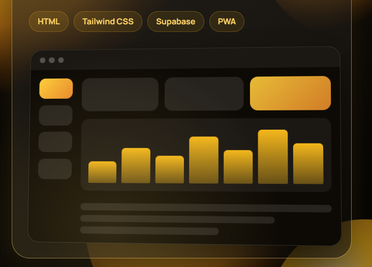

# Akramjon | UI/UX Designer & Frontend Engineer Portfolio
## Featuring: Radian Learning Center Platform Interactive Case Study

> A modern, high-converting design portfolio featuring an interactive deep-dive into the **Radian Learning Center Platform** — an EdTech SaaS and PWA with real-time seat management, Supabase RLS architecture, and student progress tracking.



---

## 🧭 Architecture & Navigation

This repository connects two experiences into one unified, responsive application:

1. **Main Portfolio (`#/` or `#/work`)**:
   - **Hero & Identity**: Designer profile, role kicker, dynamic presence beacon, and dual action CTAs.
   - **Trilingual Localization**: Instant client-side switching between **O'zbekcha (UZ)**, **Русский (RU)**, and **English (EN)**.
   - **Interactive Social Bento**: Dynamic Instagram profile card, Telegram channel with QR code scanner, and Threads.
   - **Key Metrics Grid**: 4 live client platforms, 1 full-stack app, IELTS 7.0 score breakdown, and 3 languages.
   - **Featured Work Card**: Highlights the **Radian Learning Center Platform** with live status badge, technology chips (`HTML`, `Tailwind CSS`, `Supabase`, `PWA`), and a direct link to the interactive case study.
   - **Concept Case Studies Stack**: 4 card deck showcasing Mobile Banking, E-commerce, Analytics Dashboard, and Food Delivery.
   - **5-Step UX Methodology**: Research, Wireframing, Prototyping, Usability Testing, and Final Delivery.
   - **Skills Bento & Marquee**: Technical proficiency matrix with an infinite ticker of modern design tools.
   - **Path & Education**: Career timeline and educational background.

2. **Radian Deep-Dive Showcase & Prototype (`#/radian`)**:
   - **Interactive Live Prototypes**:
     - **Student Dashboard**: 7-day glowing amber study-hour bar chart, verified milestone trackers, and real-time activity stream.
     - **Course Registration Engine**: Real-time open-seat countdown with atomic reservation locking and instant capacity sync.
     - **Admin Management Console**: Live seat editing (`+` / `-`), classroom occupancy telemetry, real working CSV roster export generator, and Supabase RLS security policy viewer.
     - **PWA Mobile Simulator**: Realistic smartphone chassis with interactive Dynamic Island alert banner, install prompt, and offline Service Worker simulation.
   - **5-Chapter UX Documentation**: Problem statement, Information Architecture, Design System with interactive hex tokens, Usability Testing progression (SUS score 68 → 91), and quantifiable business impact.
   - **Two-Way Navigation**: Seamlessly navigate between the Main Portfolio and the Radian deep dive with browser history support (Back/Forward buttons).

---

## 🛠️ Tech Stack

- **Framework**: React 19 + TypeScript
- **Bundler**: Vite 8
- **Styling**: Tailwind CSS v4 + Custom Obsidian Glass styling (`src/styles/portfolio.css`)
- **Animations**: Motion (`motion/react`)
- **Icons**: Lucide React
- **Celebrations**: Canvas-Confetti

---

## 🚀 How to Push to Your GitHub & Make Live

### Step 1: Add your GitHub Remote
If you haven't connected your remote repository yet, run:
```bash
git remote add origin https://github.com/<your-username>/<your-repo-name>.git
```
*(If `origin` already exists, update it with `git remote set-url origin https://github.com/<your-username>/<your-repo-name>.git`)*

### Step 2: Push to GitHub
```bash
git branch -M main
git push -u origin main
```

### Step 3: Make Both Live (Free 1-Click Deployment)

#### Option A: Vercel (Recommended — 30 seconds)
1. Go to [vercel.com](https://vercel.com) and click **"Add New" → "Project"**.
2. Select your imported GitHub repository.
3. Keep default settings (`Framework: Vite`, `Build Command: npm run build`, `Output Directory: dist`).
4. Click **Deploy**. Your portfolio and Radian showcase will be instantly live with global CDN!

#### Option B: GitHub Pages
1. In your GitHub repository, go to **Settings → Pages**.
2. Under **Build and deployment → Source**, choose **GitHub Actions**.
3. Use the standard static HTML / Vite workflow, or run `npm run build` and publish the `dist` directory.

#### Option C: Netlify
1. Drag and drop the `dist/` directory or connect your GitHub repository on [netlify.com](https://netlify.com).

---

## 💻 Local Development

```bash
# 1. Install dependencies
npm install

# 2. Run local dev server
npm run dev

# 3. Build for production
npm run build
```

---

## 📄 License
MIT License — Free to customize and use for your personal portfolio and showcase projects.

